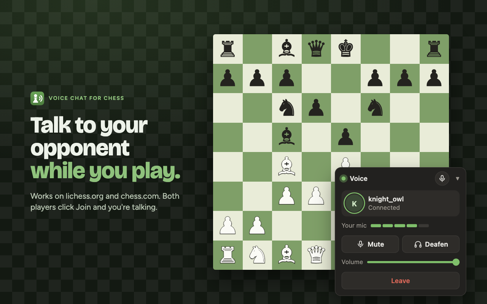
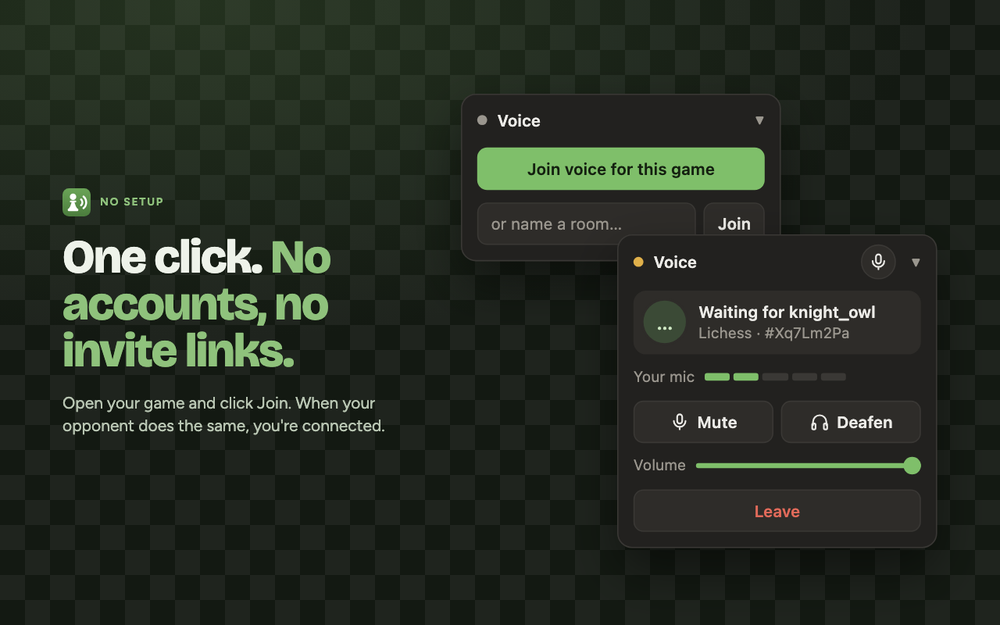
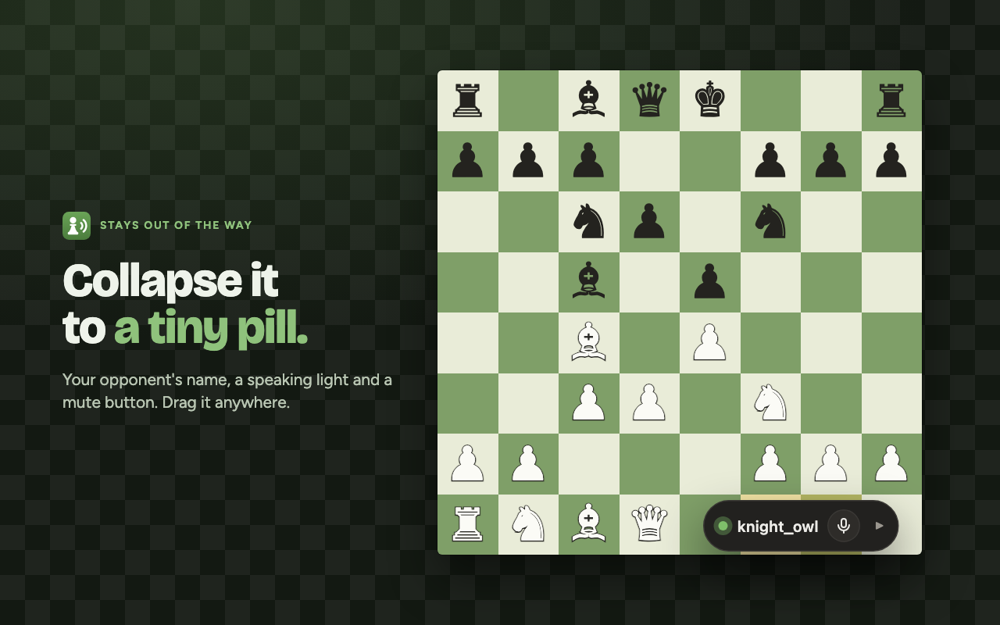
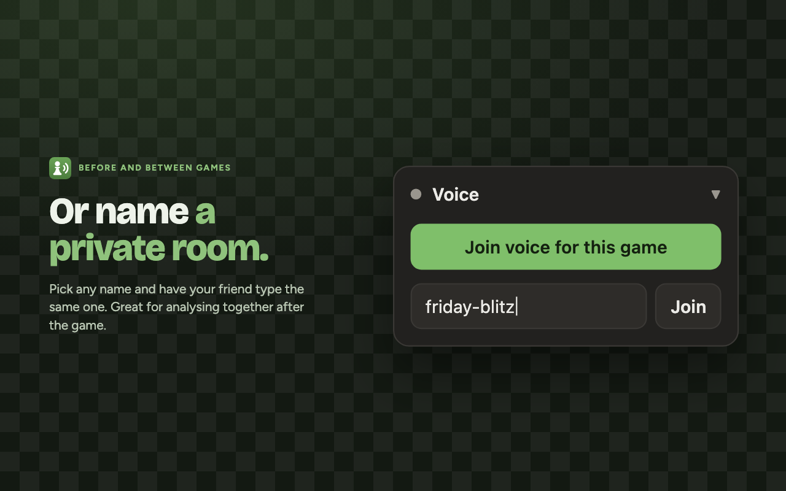
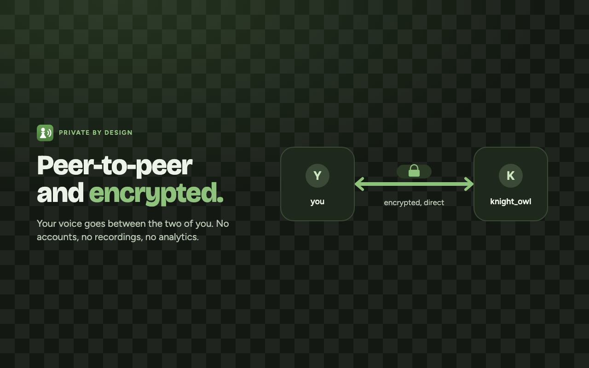

<p align="center">
  
</p>

<h1 align="center">Chess Voice</h1>

<p align="center">Talk to your opponent while you play on lichess.org and chess.com.</p>

<p align="center">
  <a href="https://github.com/siphyshu/chess-voice/actions/workflows/ci.yml"></a>
  
  
  
  <a href="LICENSE"></a>
  <!-- After the Chrome Web Store listing is live, add (replace <id>):
  <a href="https://chromewebstore.google.com/detail/<id>">?label=web%20store&color=4b7c3d" alt="Chrome Web Store"></a>
  ?color=4b7c3d" alt="Users">
  -->
</p>

<p align="center">
  
</p>

## Features

- **One click to talk.** Open a game, click **Join voice for this game**, and you're connected when your opponent does the same. No accounts or invite links.
- **Peer-to-peer and encrypted.** Voice goes between the two players' browsers, not through the developer's servers.
- **See who's talking.** A mic level meter for you and a speaking ring for your opponent.
- **Mute, deafen and volume**, plus a mute button that stays visible when the card is collapsed.
- **Shows your opponent's name** and when they're muted.
- **Keeps talking through rematches.**
- **Private rooms.** Name any room and have a friend type the same name to talk outside a game.

<table>
  <tr>
    <td></td>
    <td></td>
  </tr>
  <tr>
    <td></td>
    <td></td>
  </tr>
</table>

## Install

**From source** (Chrome, Edge, Brave, Arc):

1. Download or clone this repo.
2. Open `chrome://extensions` and turn on **Developer mode**.
3. Click **Load unpacked** and select the repo folder.

Then open a game. A **Voice** card appears in the bottom-right corner. The first time you join, a tab opens asking for microphone access. Allow it once.

Both players need the extension. Whoever joins second connects to whoever joined first.

## How it works

| File | Job |
|---|---|
| `content.js` | The Voice card. Reads the game ID from the URL and hashes it into a room key. |
| `background.js` | Service worker that routes messages between the card and the call. |
| `offscreen.js` | Owns the microphone and the WebRTC call in an offscreen document, so the call survives page navigation. |
| `permission.html` | One-time microphone permission page. |
| `vendor/peerjs.min.js` | [PeerJS](https://peerjs.com) 1.5.5, bundled. |

Both players derive the same room key from the game, then meet on the public PeerJS broker using two fixed peer IDs: the first to arrive takes `…-a` and waits, and the second takes `…-b` and calls. Audio is encrypted (WebRTC DTLS-SRTP). It flows directly between browsers, or through PeerJS's relay servers when a network blocks direct connections; the relay forwards encrypted audio and can't listen in.

See [PRIVACY.md](PRIVACY.md) for exactly what data goes where.

## Development

```sh
node scripts/check.mjs     # validate manifest, referenced files and script syntax
./scripts/package.sh       # build dist/chess-voice-<version>.zip for the Web Store
```

CI runs both on every push and uploads the zip as a build artifact. To cut a release, bump `version` in `manifest.json`, commit, then:

```sh
git tag v1.0.1 && git push origin v1.0.1
```

The release workflow checks the tag matches the manifest and publishes a GitHub release with the zip attached.

## Limitations

- **Spectators can join a game's room.** Game IDs are public, so the two seats go to whoever clicks first. Use a private room if that matters.
- **Depends on free PeerJS infrastructure.** The broker (`0.peerjs.com`) and relay servers have no uptime promise. Self-host [`peerjs-server`](https://github.com/peers/peerjs-server) and pass your own `iceServers` for reliability.
- **Chromium browsers only.** Firefox doesn't support `chrome.offscreen`.

## Fair play

Chess Voice doesn't read the board, suggest moves or interact with your game. Talking to your opponent is fine; taking move advice from anyone during a game isn't. Follow each site's fair-play rules.

Chess Voice is an independent project and is not affiliated with lichess.org or chess.com.

## License

[MIT](LICENSE). Bundles [PeerJS](https://github.com/peers/peerjs) (MIT, see `vendor/peerjs.LICENSE`).
